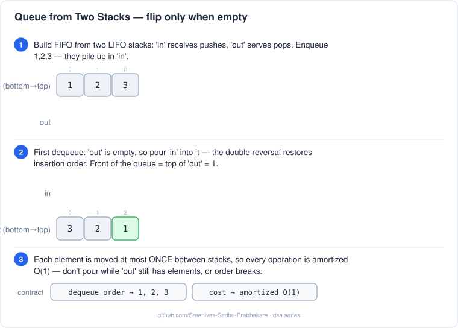

# Implement Queue Using Stacks (Amortized O(1))

> Striver SDE Sheet 078 · Day 13 Stack & Queue — an in-stack and an out-stack; two reversals make a FIFO, and each element crosses over exactly once. Go, stdlib only, tested.

## Problem

Build a FIFO queue from two LIFO stacks with amortized O(1) operations — the version interviewers mean when they say "the efficient one" (the naive version reverses everything on *every* operation).

## Approach

Pushes pile onto the **in** stack. Pops come from the **out** stack, which holds elements in reversed — i.e., arrival — order; only when it runs empty is the whole in-stack drained across (reversing it a second time). The amortized argument is the point of the exercise: any element is moved exactly twice ever (into `in`, across to `out`), so n operations cost O(n) total regardless of how dequeues and enqueues interleave. The subtle correctness detail the test pins down: elements enqueued *after* a drain must wait behind the already-reversed ones — which the two-stack separation handles automatically.

**Complexity:** amortized O(1) per operation, O(n) space.

## Visual walkthrough

Read the picture top to bottom — each numbered frame is one moment of the algorithm
running on this repo's test example.

## Run

    go test ./...   # verify
    go run .        # demo

---

One of 191 repos solving Striver's SDE Sheet in Go — stdlib only, one problem per repo, every solution tested. Browse the set: [`dsa-*` repos](https://github.com/Sreenivas-Sadhu-Prabhakara?tab=repositories&q=dsa-&type=source).
